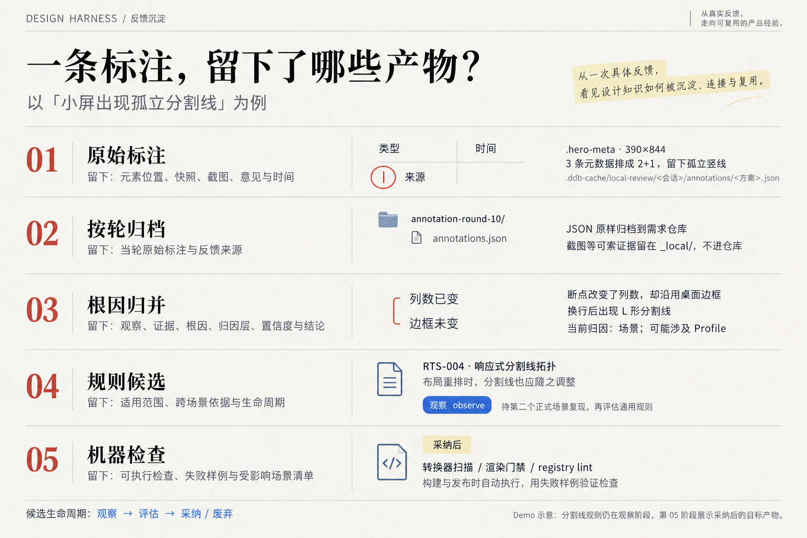
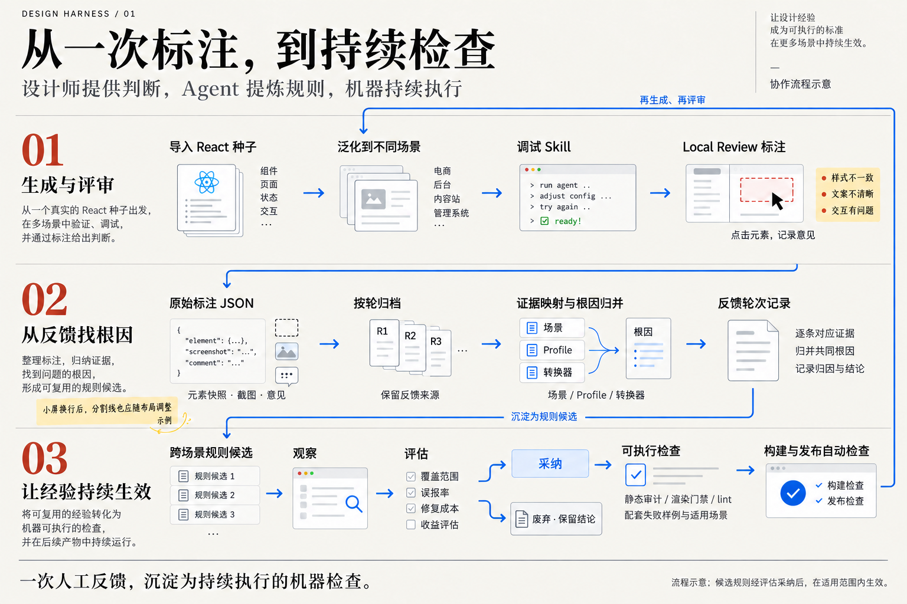

# RSI Harness 汇报文案规划

本次按 `.kimi-code/skills/narrative-tech-writing/SKILL.md` 组织叙事。项目背景与协作流程以用户最新描述为准。

一个章节对应页面上的一个 Tab，章内内容在同一个 Tab 中展开。当前先重构第一章；后续章节重新规划。本文是汇报大纲，流程描述不代表所有能力均已实现。

## 主线

设计师导入一个 React 种子项目 → Agent 泛化到不同场景 → 设计师调试 Skill 并评审产物 → Harness 根据反馈提炼可复用的设计经验 → 更新 Skill → 再生成、再评审，持续迭代。

汇报先交代项目如何运作，让听众理解设计师、Agent 和 Skill 在循环中的关系，再展开支撑这一过程的具体机制。现阶段评测能力可以不齐备，以设计师的判断为准。

## 第一章：从一个种子项目，到可复用的设计经验

**Tab 名称：项目背景**

本章回答：我们的项目在做什么？设计师如何与 Agent 协作？一次评审又如何帮助下一次生成？

### 1. 从设计师手里的一个 Demo 讲起

设计师已经有了一个 React 演示项目（Demo），其中包含具体的页面、样式和交互。我们把它作为“种子”：从这个起点出发，让 Agent 将设计做法泛化到不同场景，并在这个过程中调试技能（Skill）——一份指导 Agent 如何完成设计任务的操作手册。

我们的项目就是与设计师协同工作的 Agent Harness，可以把它理解为一张工作台：设计师在这里导入项目、调试 Skill、评审结果，Agent 则完成生成，并把反馈带回下一轮改进。

### 2. 设计师与 Agent 如何走完一轮协作？

按四个环节介绍日常工作流程：

1. **导入种子**：设计师导入一个 React 项目，为后续生成提供具体的设计起点。
2. **泛化**：Agent 基于种子项目和 Skill，面向不同场景生成新的页面或项目。这里的泛化，是让设计做法适应新的需求。
3. **调试**：设计师结合生成结果检查 Skill 的指导是否有效，调整其中的规则与表达，并重新生成来观察变化。
4. **评审**：设计师查看生成产物、体验交互，指出哪些设计值得保留，哪些存在问题，以及判断的理由。

### 3. 一条标注，怎样沉淀为可执行的设计规则？

设计师在本地评审页面（Local Review）上直接点击产物元素，写下标注意见。系统将元素快照、截图和文字意见保存为原始标注 JSON；一轮评审结束后，标注按轮次归档到需求仓库。Agent 随后逐条对应证据、归并共同根因，并判断问题属于具体场景（Scenario）、可复用的设计配置（Profile），还是负责将设计转成生成规则的转换器，形成一份反馈轮次记录。其中具备跨场景价值的根因，会被提炼为独立的设计规则候选卡，经过“观察 → 评估 → 采纳或废弃”。被采纳的规则再落成机器可执行的检查，接入转换器静态审计、渲染门禁或代码规则检查（lint），并配上能复现问题的失败样例（failure fixture）。这样，后续适用场景在构建和发布时，就能自动检查同一类问题。

这条链路要解决的是：设计师已经指出过的问题，怎样避免每次都靠人重新发现？经验既进入 Skill 的改进过程，也沉淀为持续执行的检查，让一次人工反馈能够约束后续生成。

以“小屏出现孤立分割线”为例，展示从原始标注到机器检查的五个阶段及其产物。

图注：用户提供的 Demo 摘要。分割线规则仍处于观察阶段；第五阶段展示规则被采纳后的目标产物，不代表该规则已经生效。

规则候选按 `observe → evaluate → adopted / deprecated` 流转，也就是先观察、再评估，最终采纳或废弃。用户提供的机器执行 JSON 是另一个候选示例：`candidate-a0b928fab623` 使用 `content-unbound` 失败样例，当前仍是 `evaluate / verifying`。其中的 `user_decision: approved` 表示已有用户批准记录，不能据此将它表述为已采纳、已生效，也不应将它当作分割线规则的执行证据。

### 4. 用一张流程图串起生成、评审与经验沉淀

配图已生成，采用 `DESIGN.md` 的研究刊物风格：暖白纸面、墨色标题、朱红章节号、蓝色循环箭头与少量黄色批注。

图注：协作流程示意。配图突出跨场景规则沉淀的主链路；反馈也会用于修正对应场景、Profile 或转换器，并带回下一轮生成。候选规则经评估采纳后，在适用范围内生效。

本章落点：**一次人工反馈，沉淀为持续执行的机器检查。** 设计师提供判断，Agent 整理证据并提炼规则；经过评估与采纳后，机器在规则适用范围内反复检查，让设计师把注意力放到新的设计问题上。

