# RSI Harness 汇报文案规划

本次按 `.kimi-code/skills/narrative-tech-writing/SKILL.md` 组织叙事。项目背景与协作流程以用户最新描述为准。

一个章节对应页面上的一个 Tab，章内内容在同一个 Tab 中展开。当前先重构第一章；后续章节重新规划。本文是汇报大纲，流程描述不代表所有能力均已实现。

## 主线

设计师导入一个 React 种子项目 → Agent 泛化到不同场景 → 设计师调试 Skill 并评审产物 → Harness 根据反馈提炼可复用的设计经验 → 更新 Skill → 再生成、再评审，持续迭代。

汇报先交代项目如何运作，让听众理解设计师、Agent 和 Skill 在循环中的关系，再展开支撑这一过程的具体机制。现阶段评测能力可以不齐备，以设计师的判断为准。

## 第一章：从一个种子项目，到可复用的设计经验

**Tab 名称：项目背景**

本章回答：我们的项目在做什么？设计师如何与 Agent 协作？一次评审又如何帮助下一次生成？

### 1. 从设计师手里的一个 Demo 讲起

设计师已经有了一个 React 演示项目（Demo），其中包含具体的页面、样式和交互。我们把它作为“种子”：从这个起点出发，让 Agent 将设计做法泛化到不同场景，并在这个过程中调试技能（Skill）——一份指导 Agent 如何完成设计任务的操作手册。

我们的项目就是与设计师协同工作的 Agent Harness，可以把它理解为一张工作台：设计师在这里导入项目、调试 Skill、评审结果，Agent 则完成生成，并把反馈带回下一轮改进。

### 2. 设计师与 Agent 如何走完一轮协作？

按四个环节介绍日常工作流程：

1. **导入种子**：设计师导入一个 React 项目，为后续生成提供具体的设计起点。
2. **泛化**：Agent 基于种子项目和 Skill，面向不同场景生成新的页面或项目。这里的泛化，是让设计做法适应新的需求。
3. **调试**：设计师结合生成结果检查 Skill 的指导是否有效，调整其中的规则与表达，并重新生成来观察变化。
4. **评审**：设计师查看生成产物、体验交互，指出哪些设计值得保留，哪些存在问题，以及判断的理由。

### 3. 一条标注，怎样沉淀为可执行的设计规则？

设计师在本地评审页面（Local Review）上直接点击产物元素，写下标注意见。系统将元素快照、截图和文字意见保存为原始标注 JSON；一轮评审结束后，标注按轮次归档到需求仓库。Agent 随后逐条对应证据、归并共同根因，并判断问题属于具体场景（Scenario）、可复用的设计配置（Profile），还是负责将设计转成生成规则的转换器，形成一份反馈轮次记录。其中具备跨场景价值的根因，会被提炼为独立的设计规则候选卡，经过“观察 → 评估 → 采纳或废弃”。被采纳的规则再落成机器可执行的检查，接入转换器静态审计、渲染门禁或代码规则检查（lint），并配上能复现问题的失败样例（failure fixture）。这样，后续适用场景在构建和发布时，就能自动检查同一类问题。

这条链路要解决的是：设计师已经指出过的问题，怎样避免每次都靠人重新发现？经验既进入 Skill 的改进过程，也沉淀为持续执行的检查，让一次人工反馈能够约束后续生成。

以“小屏出现孤立分割线”为例，展示从原始标注到机器检查的五个阶段及其产物。

图注：用户提供的 Demo 摘要。分割线规则仍处于观察阶段；第五阶段展示规则被采纳后的目标产物，不代表该规则已经生效。

规则候选按 `observe → evaluate → adopted / deprecated` 流转，也就是先观察、再评估，最终采纳或废弃。用户提供的机器执行 JSON 是另一个候选示例：`candidate-a0b928fab623` 使用 `content-unbound` 失败样例，当前仍是 `evaluate / verifying`。其中的 `user_decision: approved` 表示已有用户批准记录，不能据此将它表述为已采纳、已生效，也不应将它当作分割线规则的执行证据。

### 4. 用一张流程图串起生成、评审与经验沉淀

配图已生成，采用 `DESIGN.md` 的研究刊物风格：暖白纸面、墨色标题、朱红章节号、蓝色循环箭头与少量黄色批注。

图注：协作流程示意。配图突出跨场景规则沉淀的主链路；反馈也会用于修正对应场景、Profile 或转换器，并带回下一轮生成。候选规则经评估采纳后，在适用范围内生效。

本章落点：**一次人工反馈，沉淀为持续执行的机器检查。** 设计师提供判断，Agent 整理证据并提炼规则；经过评估与采纳后，机器在规则适用范围内反复检查，让设计师把注意力放到新的设计问题上。

# 当前 DDB 工作流缺失的地方

## 轨迹数据全在端侧

设计师在云侧标注，但是在端侧修改，所有的修改轨迹全在端侧，无法采集，全部浪费

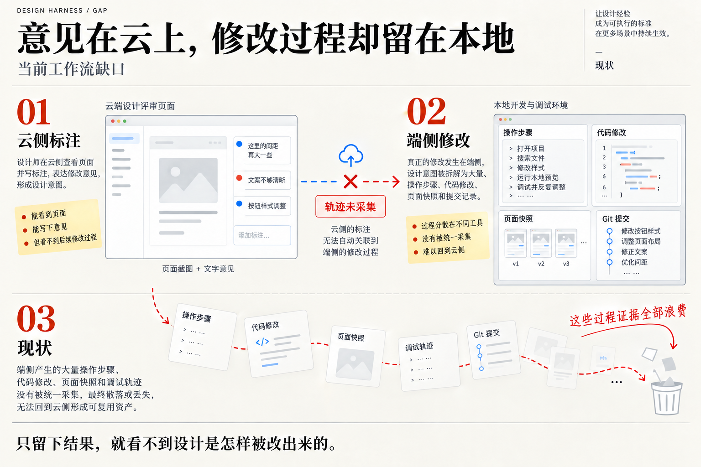

图注：当前工作流缺口。设计师在云侧标注意见，修改和调试却发生在端侧；如果操作步骤、代码修改、页面快照和 Git 提交没有被统一采集，就只剩最终结果，过程证据随之浪费。

## 缺少评测体系

没有统一收集轨迹就很难构建评测体系，全部操作人拉肩扛

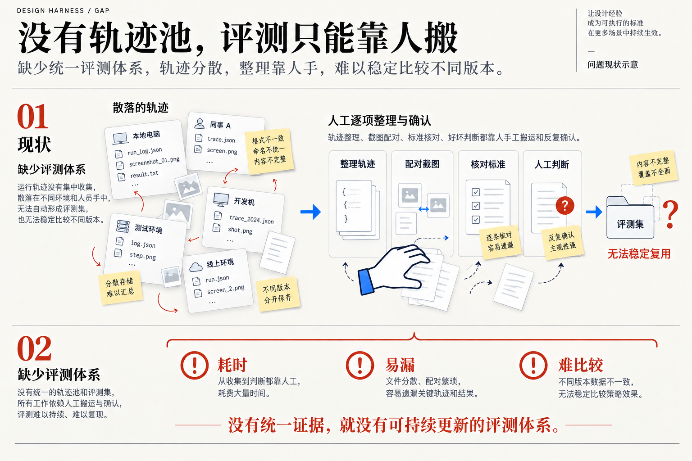

图注：缺少评测体系的现状。没有统一轨迹池时，整理轨迹、配对截图、核对标准和判断结果都依赖人工，形成的评测集也难以稳定复用和持续更新。

# 核心能力项

前面说了缺口：设计师在云侧标注、在端侧修改，过程证据全留在端侧浪费掉；没有统一轨迹池，评测只能靠人拉肩扛。那么要补上这个缺口，系统得先长出哪些能力？我们把核心能力拆成若干能力项，逐个讲清楚它的地基、抓手和落地顺序。

## 能力项一：端侧采集通道——把散落在端侧的轨迹和标注抓上来

这个能力项要回答的问题是：一次运行的全部过程证据，怎样不靠人肉搬运、自动完整地上云？

先说一个关键的架构决策：**插件不直连云端，统一调用 CLI**。同步协议和鉴权逻辑只在 CLI 里实现一份，插件保持轻量。这个决策决定了下面所有举措的先后关系。

围绕这条通道，有六项举措，按依赖关系从地基到封顶排列：

1. **快照数据契约**：先定义"一份快照里有什么、怎么互相关联"——轨迹数据（`.git` 历史）、源码、标注 JSON、`dist` 产物，用统一 ID 串联；标注里的元素快照要能稳定指回问题发生时的页面现场。契约不定死，插件、CLI、云端三家各自理解，后面必然返工。
2. **CLI 作为唯一同步入口**：承担数据管理的统一命令集（上传、下载、查询）、用户鉴权、项目归属绑定。它是插件和云端之间唯一的路。
3. **Harness 插件（轨迹侧采集）**：内嵌到不同 harness 里，挂钩任务生命周期——任务开始时建独立 mock workspace 并由 git 全程追踪，结束后把 `.git` 打包交给 CLI 静默上传，同时收敛 `dist` 产物。平台可以不同，但交给 CLI 的包格式是统一的。
4. **标注插件（标注侧采集）**：对应本地评审（Local Review）：设计师点击元素，截图、元素快照和文字意见打包成标注 JSON，按评审轮次归档。难点不在界面，而在**标注必须锚定到具体快照**——标注 JSON 里要带上它对应的运行与提交坐标。
5. **云端同步能力**：静默后台上传，不打断设计师的工作流；利用 git 协议做增量传输，避免每次全量；断点续传加离线队列，端侧离线干活、联网自动补传；体积治理——排除 `node_modules`、大二进制走单独通道，否则 `.git` 上传会成为体验杀手。
6. **云端接收与一致性校验**：上传不是终点。云端收到后校验这份快照是否完整——轨迹、源码、标注三者是否齐全、ID 是否互相对得上，残缺的标记出来而不是静默丢弃。这是快照语料一致性的入口把关。

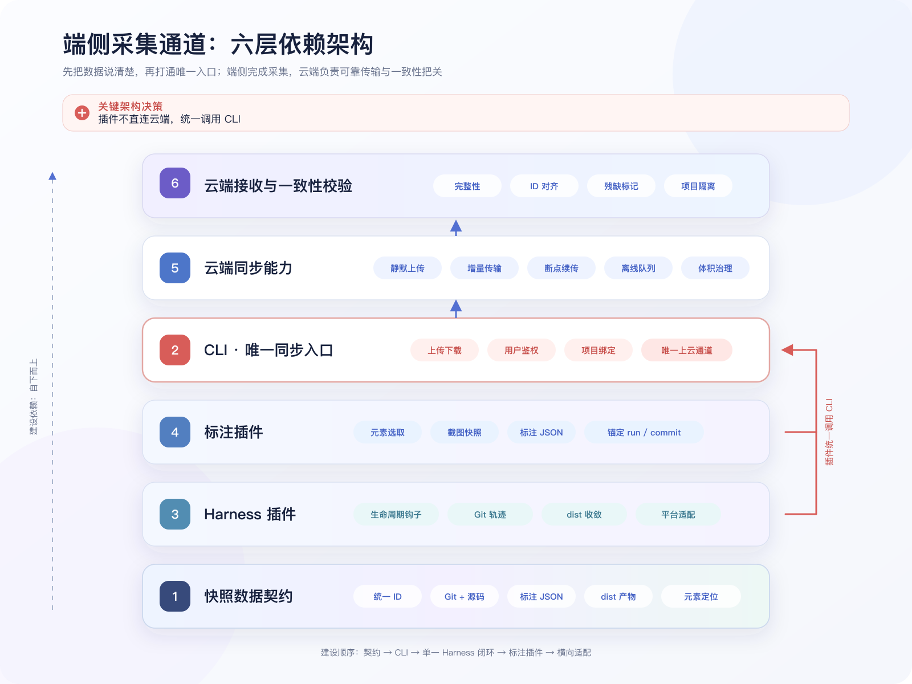

图注：端侧采集通道六层依赖架构。建设顺序自下而上；运行时，Harness 插件和标注插件都先调用 CLI，再由 CLI 通过唯一上云通道完成同步，插件不直接连接云端。

落地顺序上，建议先打穿一条线再横向铺开：契约 → CLI 骨架 → 挑一个 harness 做插件打样，跑通"一次运行完整上云"的最短闭环 → 再做标注插件 → 最后铺到其他 harness。六条线并行铺开的风险，远大于先验证一条。

## 能力项二：快照语料模型——抓上来的东西，凭什么算一份合格语料？

能力项一解决"怎么抓"，能力项二回答"抓上来的东西长什么样"。如果说数据契约定义的是信封格式，语料模型定义的就是信封之上的户籍制度：血缘怎么算、一致怎么判、什么时候算正式语料。它拆成六层：

1. **三段式组成定义**：一份快照 = 前置轨迹 + 源码 + 后置标注，三段缺一不可。前置记录这次运行从哪来——种子项目版本、任务问题（query）、用的哪版 Skill、执行环境；轨迹记录过程中发生了什么——git 全程的提交历史与操作步骤；后置记录结果与评价——`dist` 产物、标注 JSON、评审结论和（未来的）分数。
2. **唯一标识与血缘（lineage）**：每份快照一个 ID，三段数据互指。更重要的是血缘：这份快照由哪个种子、哪道题、哪版 Skill 生成，又是哪份快照的分叉或迭代。血缘链断了，"这次改 Skill 到底有没有变好"就无从比较。
3. **"一致性"的可执行判定规则**：三者一致不能停在口号，要落成可检查的硬规则——标注 JSON 里的元素坐标能映射到对应提交的源码；轨迹的 git 终态与 `dist` 的构建来源一致；前置段引用的 Skill 版本真实存在。能力项一的入口校验就是执行这些规则的第一道关。
4. **快照不可变，修正靠新增**：归档后的快照不可改写，要修正就产生新快照。这是评测可复现的前提——评测集引用的快照如果被悄悄改了，"高低分正确区分"就失去意义。
5. **存储组织：分开存、统一聚合**：源码历史走 git 仓库，截图和 `dist` 走对象存储，血缘和索引走元数据库，逻辑上以快照 ID 聚合、按项目隔离。同时要提供检索能力：按场景、Skill 版本、分数区间捞快照，这是后面组评测集的操作基础。
6. **语料化出口：从原始包到可被引用**：采集上来的只是"原始包"，过了校验、建了血缘才算进入轨迹池成为正式语料，之后才能被评测集、用例集引用。集合只是快照的引用视图，不复制数据——这条定义了语料模型和资产管理、评测体系之间的接口。

### 评测 Agent 怎么用快照训练自己的判别能力？

有了语料，评测 Agent 的判别能力不是写死的规则，而是从快照里练出来的。训练循环是"做题 → 对答案 → 反思 → 再做题"：先对一批快照做判别，再拿判断和后置标注里的设计师意见核对，找出判错和漏判的，由另一个模型把错漏归纳成共性，最后带着归纳调整自己、换一批再测，直到达标（比如准确率 90% 以上）。

这个循环要成立，有两个关键约束：

- **标准答案就在快照里**：评测 Agent 判的是前置、轨迹和产物，对答案对的是后置标注。这就是为什么标注必须锚定到具体快照——锚不上，就没法当训练标签用。达标线必须划在**从没见过的验证批**上：在训练批上测出的 90%，分不出是学会了还是背下来了。
- **防背答案要靠机制，不靠要求**：迭代之间只允许传递规则、不允许传递答案——评测 Agent 带到下一轮的只有一份自然语言写的判别准则，个案答案被强制遗忘；归纳是否真共性，交给没见过训练批的干净 Agent 独立执行来检验；再把容易误判的对照例（failure fixture）混进验证批挤水分。归纳出的准则本身也是资产，可以像 Skill 一样版本化，与规则候选卡的治理流程共用。

## 能力项三：云端资产管理——资产存在哪、谁能动、怎么管？

能力项一采集、能力项二立规矩，能力项三回答管理问题。架构设计里已有骨架——"云端负责存储核心资产，按项目区分，配套用户鉴权"，这句话展开正好是三层包含关系：用户进项目，资产归项目。

**用户管理：谁能进来，能干什么**

- **账号与鉴权**：云端统一认证，端侧 CLI 持登录态——能力项一说的鉴权，云端这半边落在这里。
- **角色与权限**：呼应角色分工一章，设计师、开发、算法三类角色对不同资产有不同操作边界。谁能把实验版 Skill 合入稳定主线、谁能采纳规则候选，不能人人可为，否则规则治理就乱了。
- **行为归属**：每条标注、每次 Skill 改动、每次规则采纳都带作者。"这条规则当初是谁为什么采纳的"要查得到。

**项目管理：资产的隔离边界与协作空间**

- **项目即边界**：所有资产按项目隔离，不同项目互相不可见——多团队、多客户场景下的安全底线。
- **项目绑定源头**：一个项目绑定它的种子项目和需求仓库，"标注按轮次归档到需求仓库"就是项目级的归档规则。
- **成员与端云绑定**：谁在项目里、什么角色；CLI 上传的快照落在哪个项目。
- **协作空间而不只是权限墙**：设计师标注意见、开发调 Skill、算法挖数据，三方在同一个项目里围绕同一批资产工作。

**资产管理：四类核心资产，围绕快照组织**

- **Skill 版本**：fork / merge / rollback，实验版本验证前不进稳定主线。
- **用例集**：query + 附件 + 验收标准三件套，版本化的基准测试集——光有题没有验收标准，好坏无从评判。
- **轨迹与快照**：来自能力项一采集、能力项二验明正身后的轨迹池。
- **评测集**：快照的引用视图而非数据复制，同一条轨迹可进多个集合。
- **共性治理能力**：版本化、检索、引用关系追踪。

**一条贯穿线：资产之间的引用关系。** 四类资产不是四个孤立的仓库：一道用例触发一次运行，产生一份快照，被多个评测集引用，又由某版 Skill 生成。改一版 Skill 会影响哪些评测、一份低分快照能不能回溯到用例和 Skill 版本——这条血缘链查得通，资产管理才算立住，否则就是四个互不相干的网盘。权限与审计则贯穿三层：用户管身份、项目管边界、资产管版本，每个敏感操作（合入主线、采纳规则、发布评测集）都要过权限、留记录。

### 云端 server 怎么建？

管理层面的三支柱要落到工程上，云端 server 拆成四层：Web 控制台与 CLI 共用同一个 API 层，业务层按用户、项目、资产、血缘划分领域服务，存储层三类存储各司其职，审计日志贯穿所有层：

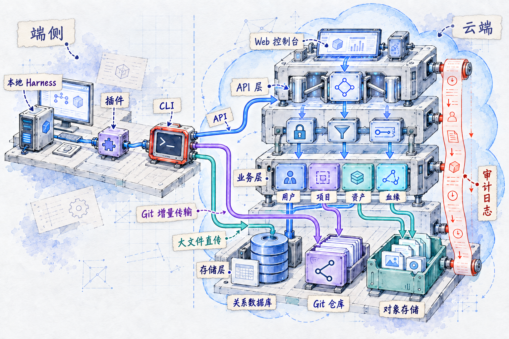

图注：云端 Server 分层架构。Web 控制台与 CLI 共用 API 层，用户、项目、资产与血缘服务置于同一模块化业务层；关系数据库、Git 仓库与对象存储各司其职。Git 类资产和大文件分别沿独立通道直达对应存储，审计日志贯穿云端各层。

同一架构的精确结构图（mermaid，采用 ELK 布局保证分层对齐，渲染器需支持 mermaid ELK）：

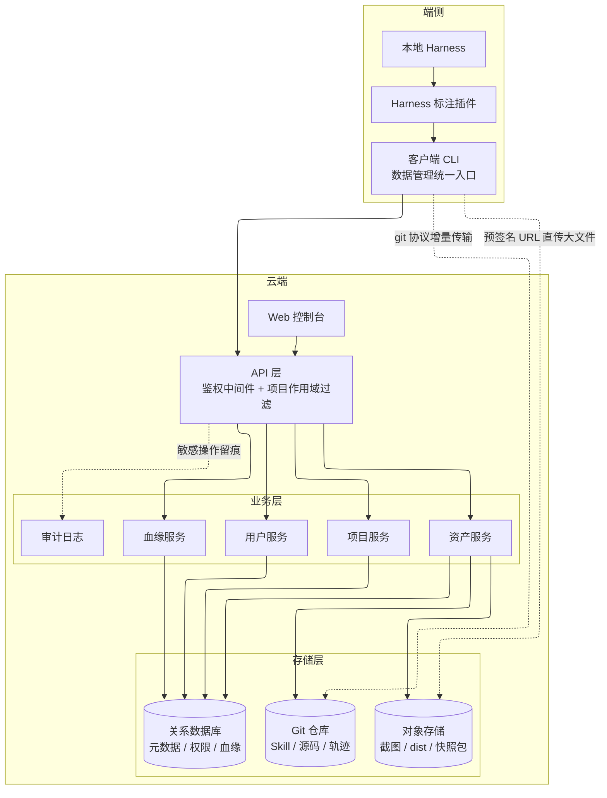

落到具体技术决策上，有六点：

1. **三类存储分离**：对应能力项二的"分开存、统一聚合"——元数据进关系数据库（如 Postgres），大文件走 S3 兼容对象存储，代码类资产走 git 仓库，API 层把同一快照 ID 的三处数据聚合成一个视图。
2. **Skill 版本管理复用 git 语义，不重复造轮子**：fork = 分支、merge = 合并、rollback = revert，三个动作 git 原生就有，还白捡差异比较和历史追溯。业务层只做"稳定主线保护"这层治理——合入需权限加评测验证。
3. **权限模型：RBAC + 项目作用域令牌**：角色 × 资产类型 × 操作构成权限矩阵；CLI 用设备授权流程或个人访问令牌登录，令牌绑定项目作用域，天然实现"上传只能落在自己项目里"；敏感操作在 API 层统一拦截并写审计日志。
4. **血缘用关系表加查询 API 实现，不上图数据库**："用例 → 运行 → 快照 → 评测集"就是几张带外键的关联表，影响面分析本质是一次递归关联查询。早期不引入重组件，关系库的递归查询足够。
5. **上传协议分两条通道**：git 类资产走 git 协议，增量和断点续传白得；截图和 `dist` 产物走对象存储的预签名 URL 直传，大文件不经过业务服务器，服务端只收元数据回执。
6. **部署形态：模块化单体起步**：四个领域服务先放在一个进程里，用模块边界隔离，不急着微服务化——资产管理早期最大的成本是 schema 演进，单体改起来最快；同时要支持私有化部署，多客户场景下数据不出内网是硬需求。

这套架构和前面的理论正好咬合：用户、项目、资产三支柱落在业务层的领域服务上，引用关系贯穿线落在血缘服务上，权限与审计贯穿线落在 API 层中间件上。理论讲"管什么"，这层讲"用什么管"。

# 流程与功能设计

前面讲了设计师和 Agent 如何走完一轮协作。那么，要让这个循环真正跑起来，系统需要哪些功能支撑？

一次循环（loop）其实只有三个动作：**生成 → 反馈 → 更新**，然后回到新的生成。围绕这三个动作，我们把系统拆成六个功能模块：场景用例管理、执行环境管理、标注系统、Skill 版本管理、轨迹和快照管理、评测体系。

## 场景用例管理

场景用例管理本质上就是一个 benchmark（基准测试集）——一份"考题清单"。光有题目（query）还不够：每道题要带上对应的附件，更重要的是要有明确的验收标准，否则生成的好坏无从评判。

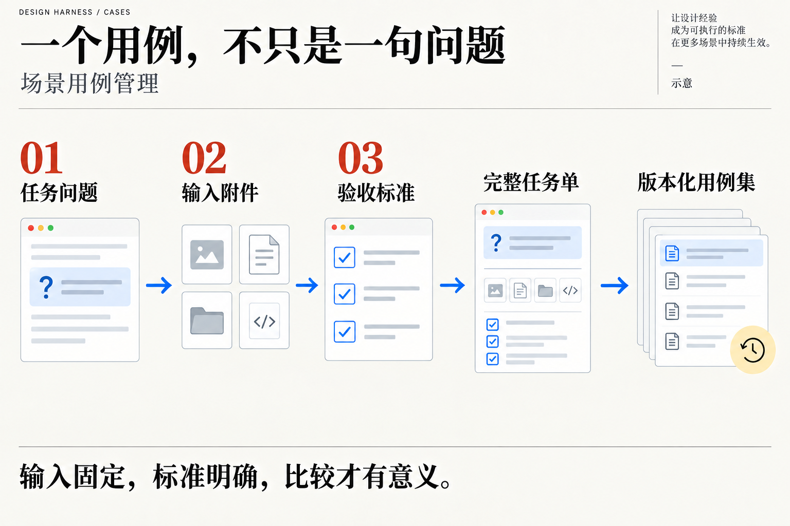

图注：场景用例管理示意。只有同时固定输入与验收标准，不同运行之间的比较才有意义。

## 执行环境管理

系统要能对接不同的执行平台，任务跑完后把轨迹（trace）和产物统一收集回来。产物统一收敛到一个 `dist` 文件夹，后续评审和评测都以它为准。

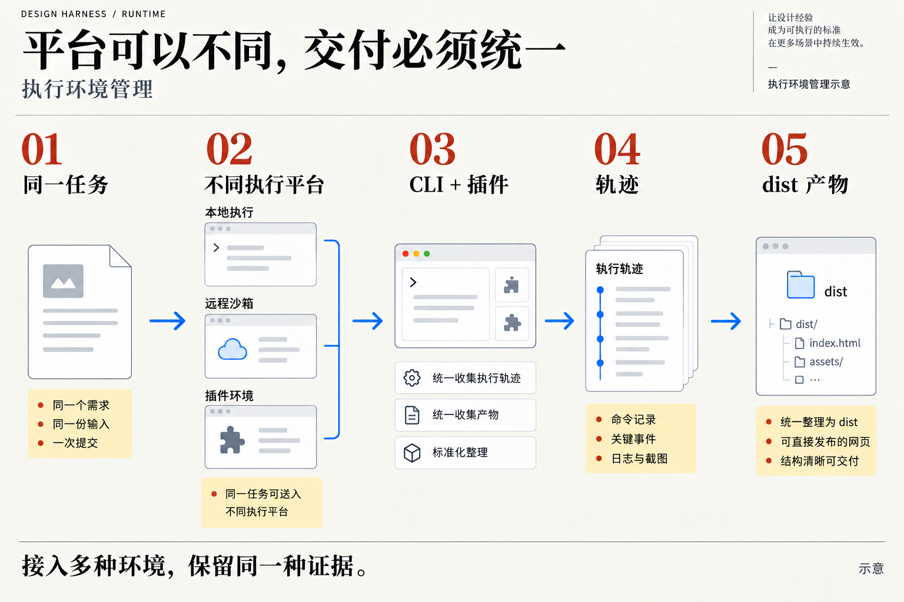

图注：执行环境管理示意。平台可以不同，但轨迹证据和最终 `dist` 交付结构需要统一。

## 标注系统

把页面元素可视化地呈现出来，设计师直接在元素上标注，意见和元素一一对应，不再靠口头描述"那个按钮"。

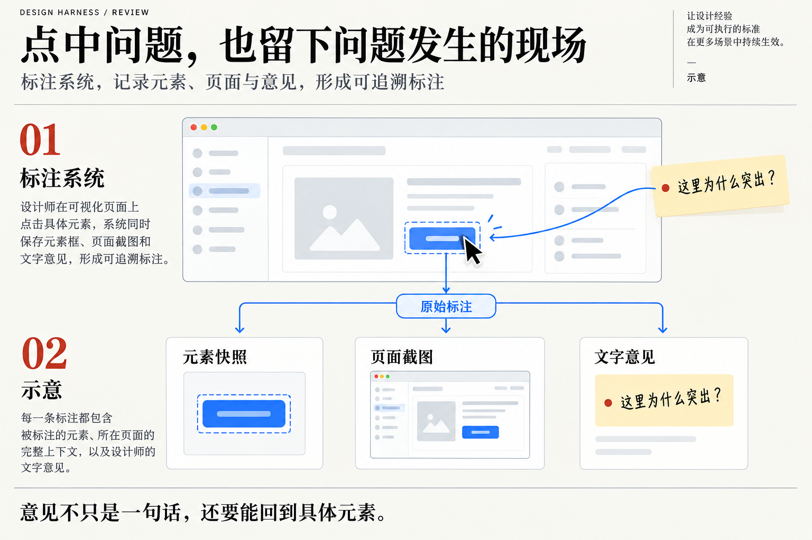

图注：标注系统示意。意见不仅是一句话，还要能够回到具体元素和问题发生时的页面现场。

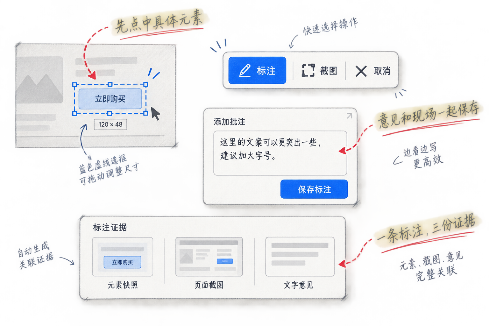

图注：标注系统产品组件拆解。设计师先选中具体元素，再填写意见；元素快照、页面截图与文字意见作为一组证据保存。

## Skill 版本管理

Skill 要像 git 一样管理：支持分叉（fork）、合并（merge）、回退（rollback）。每一次改动都有版本可查，改坏了能随时退回去。

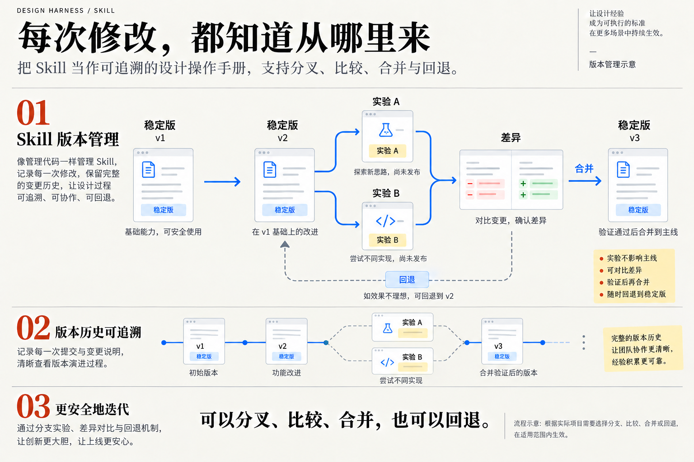

图注：Skill 版本管理示意。修改可以分叉、比较、合并和回退，实验版本在验证前不进入稳定主线。

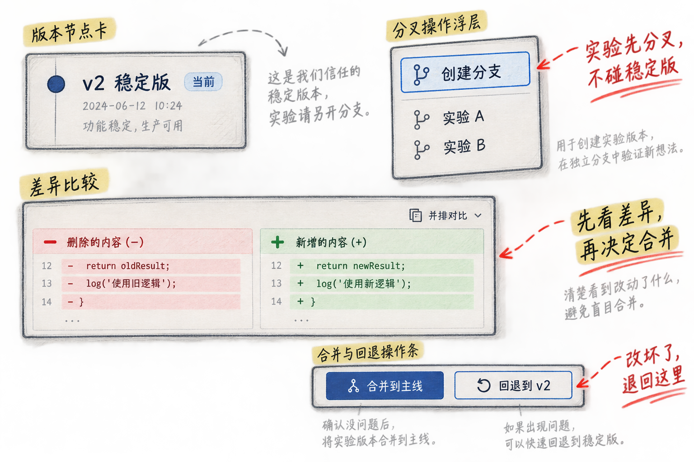

图注：Skill 版本管理产品组件拆解。实验从稳定版本分叉，先比较差异，再选择合并到主线或回退。

## 轨迹和快照管理

每条执行轨迹都在一个独立的 mock workspace 中运行，并由一个 git 仓库全程追踪。执行结束后，把 `.git` 目录静默上传到云端——完整的变更历史随之上云，随时可以复盘。

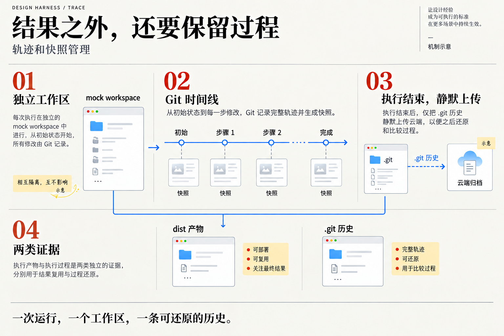

图注：轨迹与快照管理示意。`dist` 产物用于复用结果，`.git` 历史用于还原和比较执行过程。

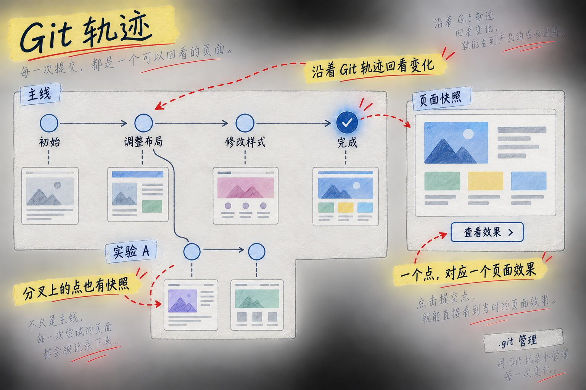

图注：轨迹与快照产品组件拆解。Git 管理主线与实验分叉；轨迹上的每个提交点都对应一个页面效果快照，设计师可以沿着分支逐点查看页面如何变化。

## 评测体系

评测体系本身也要不断进化：它要持续识别轨迹和快照，看出快照之间的差异，并按快照的进展打分，把高分和低分正确区分开。

整体上这是两个 Agent 的对弈——负责评测的和负责生成的都要不停迭代，有点像 Agent 版的 GAN（生成对抗网络）：一个出题改卷，一个答题应考，互相逼着对方进步。

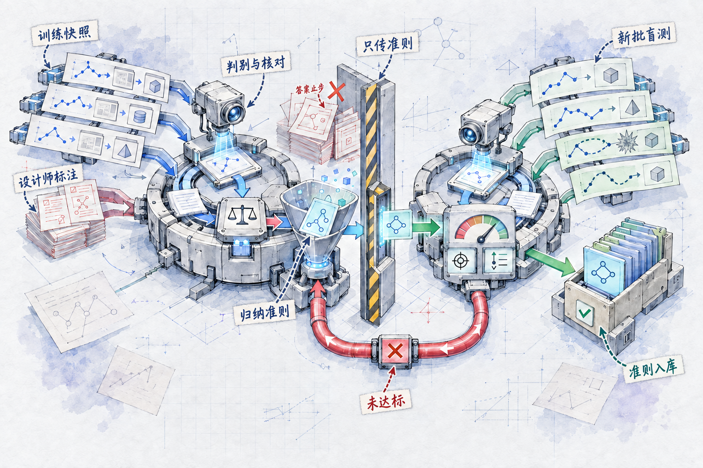

图注：评测 Agent 的目标学习机制。左侧训练环用设计师后置标注核对判断并归纳共性；中央隔离门只允许准则进入下一轮，不传递个案答案。右侧在未见过且包含对抗样例的新快照上盲测，未达标沿红色回路继续归纳，达标后的准则进入版本化治理。该图不代表相关能力已经完整实现。

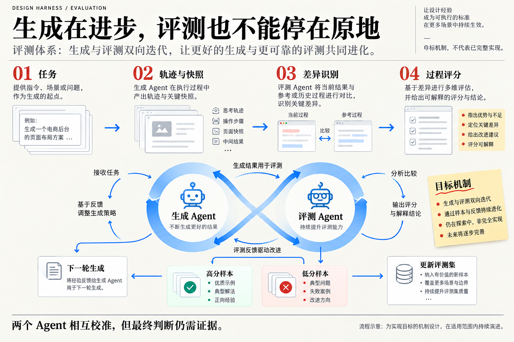

图注：双 Agent 评测的目标机制。生成与评测共同迭代，高低分样本分别反馈到下一轮生成与评测集更新；该图不代表相关能力已经完整实现。

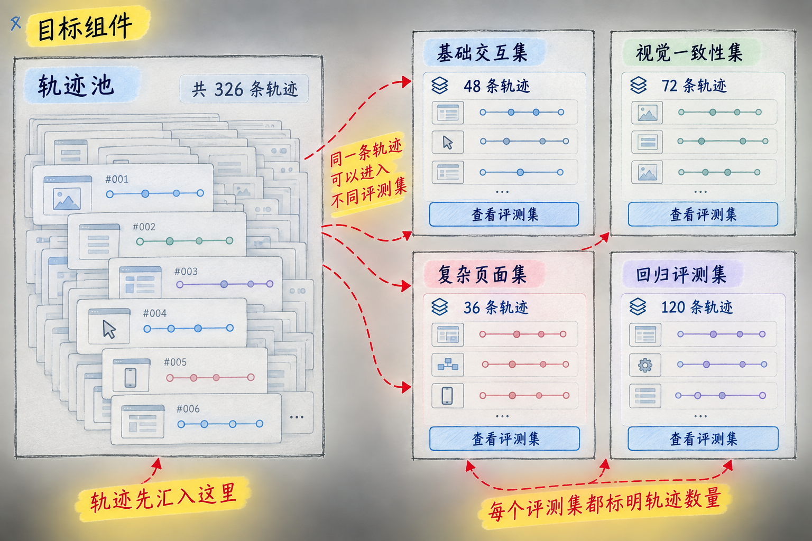

图注：评测体系的目标组件拆解。大量运行轨迹先汇入轨迹池，再按评测目的组成不同评测集；每个评测集明确显示所包含的轨迹数量，同一条轨迹也可以进入多个集合。图中数量仅作产品设计示意，不代表真实数据。

# 架构设计

架构上采用端云结合的方式。云端负责存储核心资产：Skill 版本、用例、轨迹、快照、评测集等，并按项目区分，配套用户鉴权。

系统有四个主要模块：

- **云端 server**：资产存储与鉴权；
- **客户端 CLI**：数据管理的统一入口；
- **插件系统**：内嵌到不同的 harness 里，通过调用 CLI 管理数据；
- **本地 harness**：实际执行生成任务的环境。

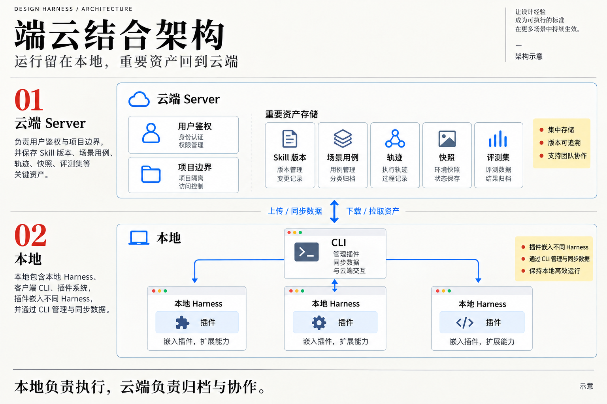

图注：端云结合架构示意。本地侧负责执行，云端侧负责鉴权、项目隔离以及重要资产的归档与协作。

# 角色分工

整个流程分三个阶段，每个阶段的主导角色不同：

1. **Demo 生产**：纯粹的设计环境，由设计师主导；
2. **场景泛化 &amp; Skill 打磨**：开发与设计师共创；
3. **数据挖掘**：由算法主导。

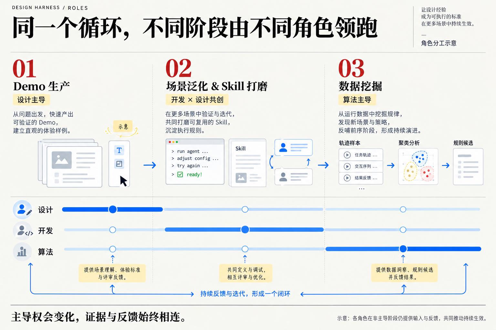

图注：角色分工示意。主导权随阶段变化，但设计、开发和算法并非彼此割裂，三方始终通过证据与反馈参与同一个循环。
